# Project 1: Entra ID + Conditional Access

## Goal
Contoso's people exist in Entra ID, organized into groups, licensed, able to reset their own passwords, and protected by Conditional Access.

## Summary
Set up the identity layer for Contoso in a dedicated Microsoft Entra ID tenant: users created three ways, assigned and dynamic groups, group-based P2 licensing, self-service password reset for a pilot group, and a least-privilege helpdesk role. Access is protected by three Conditional Access policies (MFA for admins, block sign-ins outside the US, block legacy authentication), each tested in Report-only and What If before MFA was enforced, with a break-glass account excluded throughout. Later projects reuse these users and groups.

## Architecture
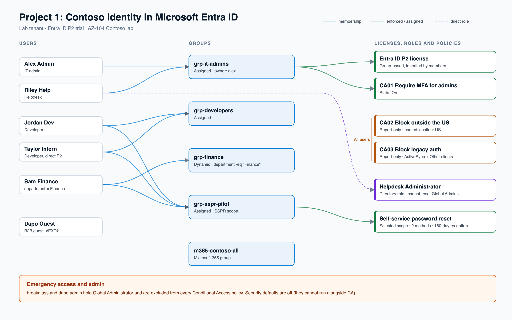

## What I built
- Dedicated lab tenant (separate from my school directory) with a native Global Administrator account for daily admin work
- Microsoft Entra ID P2 trial (100 licenses, recurring billing off)
- Break-glass emergency access account (Global Administrator, to be excluded from every Conditional Access policy)
- Five Contoso users created three ways: portal (alex, jordan), bulk CSV upload (sam, riley), and Azure CLI (taylor)

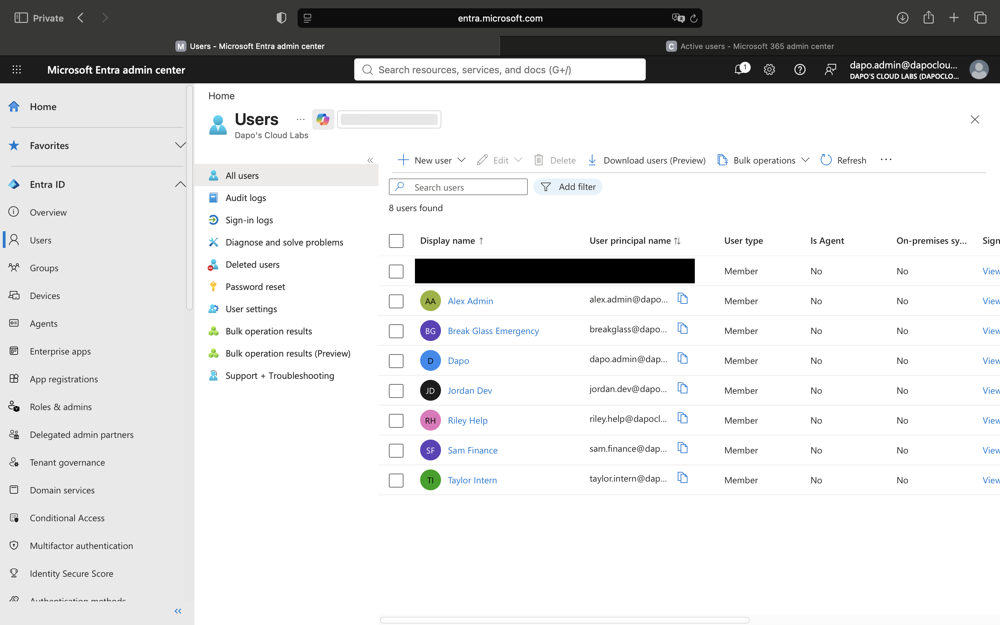

- Five groups: assigned security groups for IT admins (with a group owner), developers, and an SSPR pilot; a dynamic security group for Finance (`user.department -eq "Finance"`); and a Microsoft 365 group for the whole company

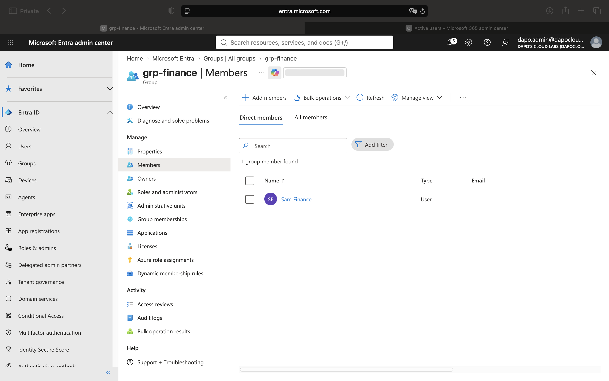

- Group-based licensing: Entra ID P2 assigned to `grp-it-admins`, inherited by its members; a direct assignment on one user for comparison

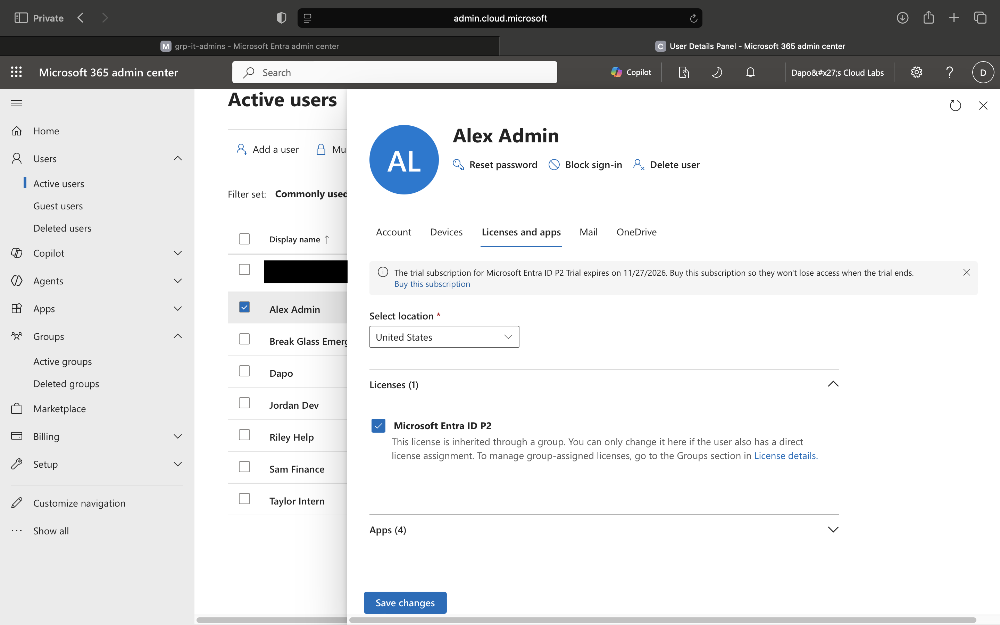

- Invited an external guest (B2B collaboration) and compared it with an external member account

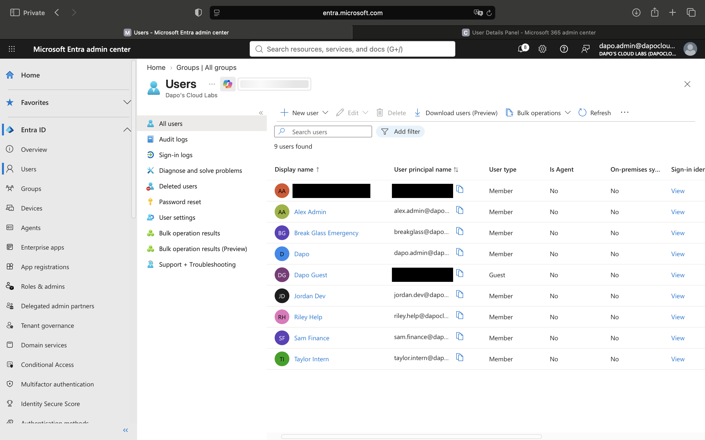

- SSPR scoped to a pilot group: 2 methods required, registration enforced at sign-in, reconfirm every 180 days, user and admin notifications
- Least-privilege directory role: Helpdesk Administrator for the helpdesk user, verified it cannot reset a Global Administrator's password

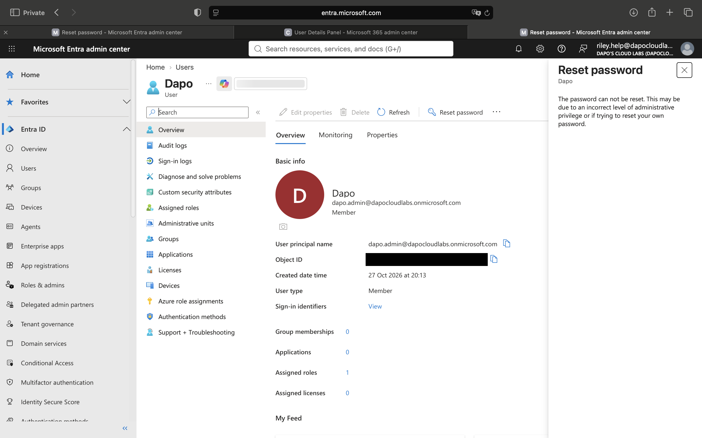

- Conditional Access (security defaults off, `loc-united-states` named location), three policies in Report-only, each excluding break-glass and my admin account:
  - CA01 Require MFA for admins (`grp-it-admins`)
  - CA02 Block sign-ins outside the US (All users, any location except the US)
  - CA03 Block legacy authentication (Exchange ActiveSync and Other clients)
- Simulated with What If: alex from the US gets CA01 only (CA02 skipped on Location, CA03 on Client app); taylor from Canada gets CA02 only (CA01 skipped on Users and groups)

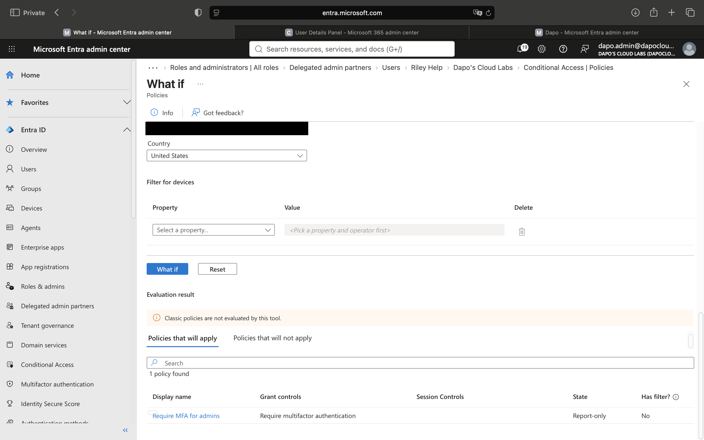
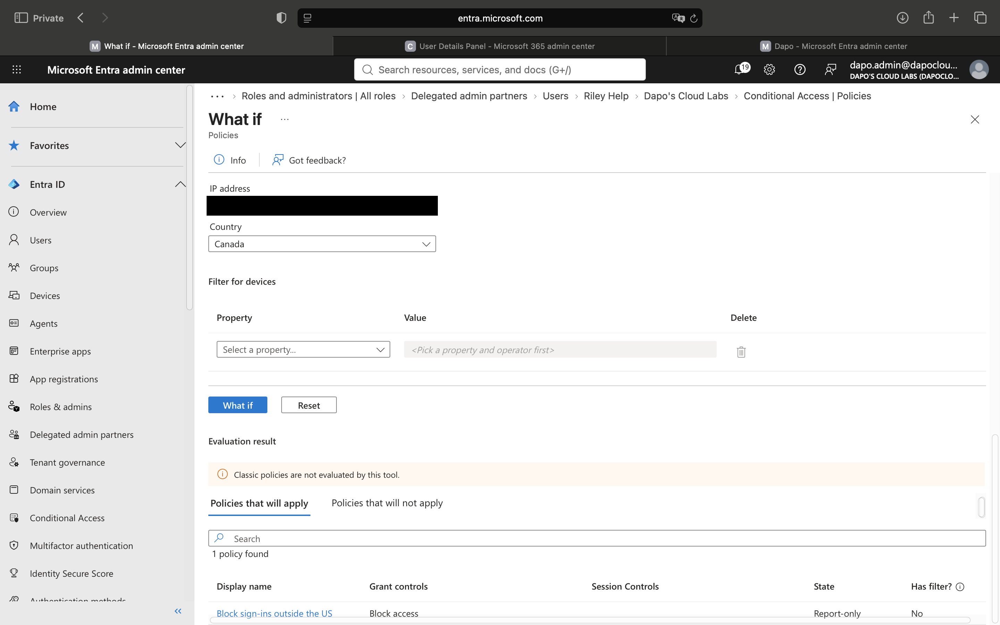
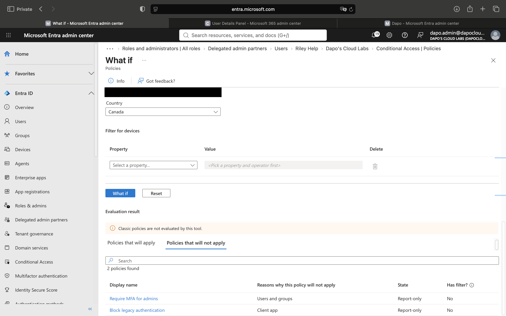

- Switched CA01 to On. alex was forced to register Microsoft Authenticator, then signed in with MFA. The sign-in log shows the whole sequence:

| Status | Error code | Meaning | Conditional Access |
|---|---|---|---|
| Failure | 50126 | Wrong username or password | Not Applied (CA runs only after primary auth) |
| Interrupted | 50072 | User must register for MFA | Failure (CA01 required MFA, none registered yet) |
| Interrupted | 50140 | "Stay signed in?" prompt | Success |
| Success | 0 | Signed in with MFA | Success |

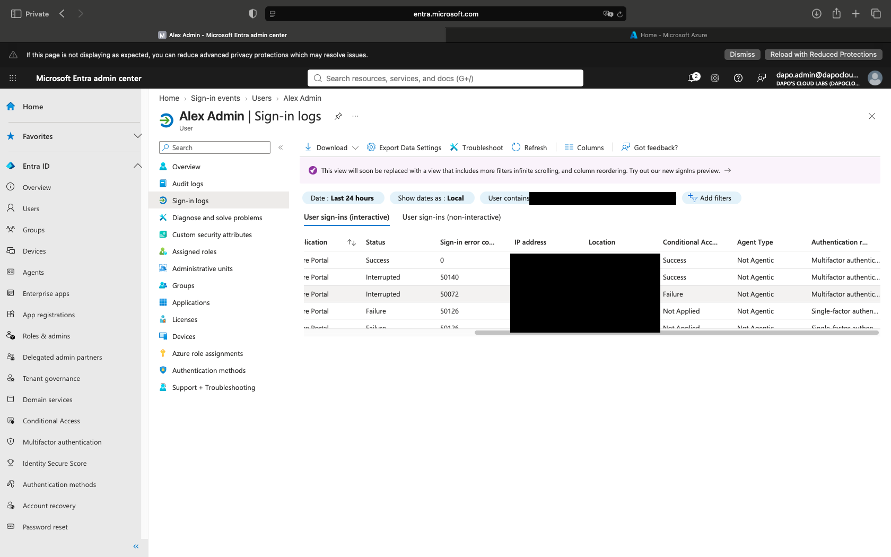

- Break it: typo in the dynamic group rule, diagnosed with Validate Rules

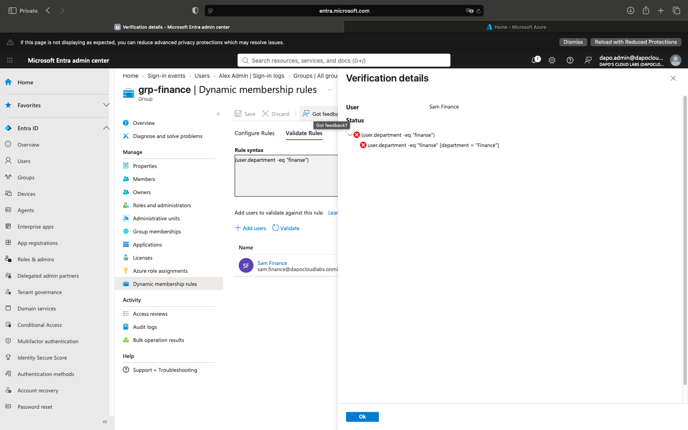

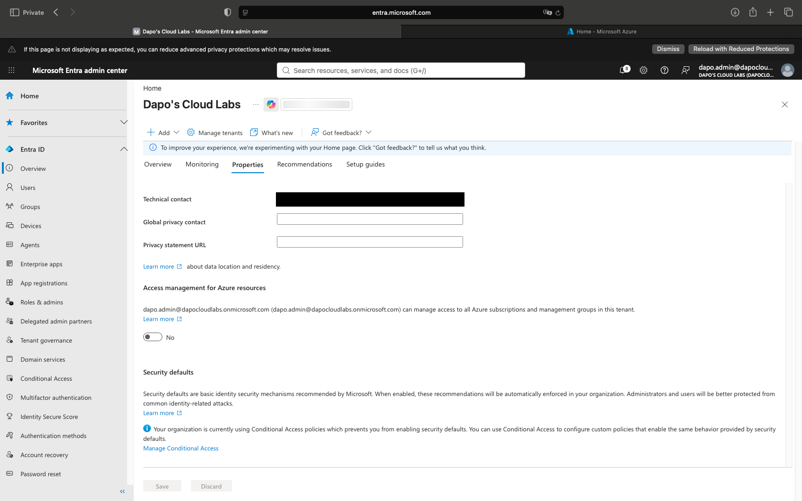

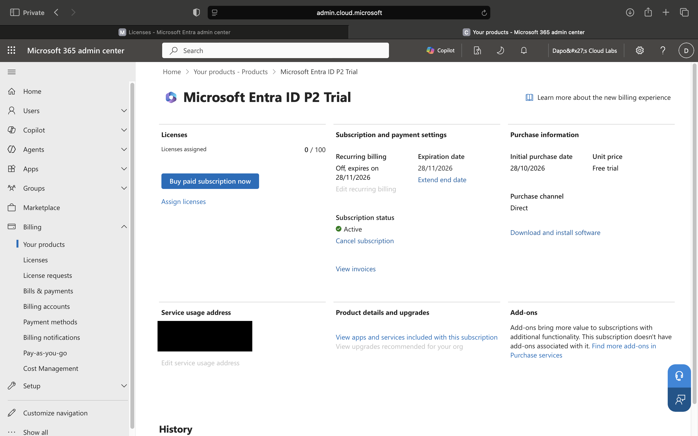

## Exam objectives covered
- [x] Create users and groups
- [x] Manage user and group properties
- [x] Manage licenses in Microsoft Entra ID
- [x] Manage external users
- [x] Configure self-service password reset (SSPR)
- [x] Conditional Access (security defaults, named locations, Report-only, What If)

## Break/fix log
| What I broke | Symptom | Root cause | Fix |
|---|---|---|---|
| Opened Entra while signed into my school directory | `401` "Error loading your content" | The portal session was in a directory where I am a regular user, not an admin | Switched directory to my own lab tenant |
| Looked for my Azure for Students subscription in the new tenant | Subscriptions list showed 0 of 0 | A subscription belongs to the directory it was created in, not to the user | Tried Change directory on the subscription (see next row) |
| Tried to move the student subscription into my tenant | "Your current settings do not allow you to transfer this subscription" | The school tenant's subscription policy blocks subscriptions leaving the directory | Kept the subscription where it is; lab identity work runs in my own tenant |
| Created the `dapo.admin` user a second time | "User principal name already exists in this directory" | The first create had succeeded; the list had not refreshed | Refreshed the user list. If a user is soft-deleted, restore or purge it from Deleted users |
| Tried to assign Global Administrator from the user's Assigned roles picker | Role not listed in the picker | Picker in that view did not offer the role | Assigned it from Roles and administrators > Global Administrator > Add assignments |
| Started the P2 trial from the public signup page | Prices shown in GBP and a 1-year paid term after the trial | The public signup page localizes and offers a paid-conversion flow | Bought through the Microsoft 365 admin center: Marketplace > Start free trial, then turned recurring billing off |
| Created a user in the Microsoft 365 admin center | Form auto-built the UPN as `AlexAdmin@` and assigned a P2 license directly | The M365 admin center is a licensing-first view and prompts for a license at creation | Cancelled and created the user in the Entra admin center, which assigns no license |
| Put "United States" in Office location | Would have left usage location empty, blocking license assignment | Office location is free text; Usage location is the licensing country | Set Usage location in the Settings section of the Properties tab |
| Bulk create with the CSV template | Template had no `version:v1.0` row and used `Account enabled (true/false)` | Microsoft updated the bulk create template; jobs for it log under Bulk operation results (Preview) | Always fill the freshly downloaded template; check the Preview results page |
| Ran `az ad user create` with a password containing `!` in double quotes | `zsh: event not found` | zsh history expansion treats `!` inside double quotes as a history reference | Wrapped the password in single quotes |
| SSPR authentication methods page | Only "Security questions" offered; other methods missing | Microsoft moved SSPR methods into the unified Authentication methods policy (shared by MFA and SSPR) | Set required methods on Password reset, enabled Authenticator, SMS, and Email OTP under Authentication methods > Policies |
| Tested SSPR as jordan at aka.ms/sspr | "You can't reset your own password because password reset isn't properly set up for your organisation" | **Open.** Likely causes: jordan has fewer registered methods than required, fewer than 2 methods enabled for jordan in the policy, scope, or propagation delay | To diagnose: check Users > Jordan Dev > Authentication methods first |
| What If tool | Required an IP address as well as a country | The current What If form treats IP address as required in sign-in conditions | Used a public DNS IP matching the chosen country (US, Canada), never my own IP |
| Checked alex's sign-in for CA01 | Conditional Access tab said "Not applicable" although alex got the MFA prompt | I opened a 50126 wrong-password row. CA is evaluated only after the password succeeds, and one sign-in writes several rows | Added the Status, Sign-in error code, and Conditional Access columns and opened the Success (code 0) row |
| Dynamic rule `(user.department -eq "finance   ")` with trailing spaces | sam stayed a member; processing status Succeeded, no membership change | The match still succeeded: `-eq` is case-insensitive, and the trailing spaces did not stop the match (most likely trimmed) | Used a real typo, `"Finanse"`, to break it |
| Dynamic rule `(user.department -eq "Finanse")` | Validate Rules: sam fails, `department = "Finance"` | Rule value does not match the user's attribute; no error is raised, the user just silently drops out | Corrected the value to `"Finance"` |
| Tried to turn security defaults back on with CA policies active | No Manage security defaults link; "Your organization is currently using Conditional Access policies which prevents you from enabling security defaults" | Security defaults and Conditional Access are mutually exclusive | Left security defaults off; CA policies provide the same protections |

## Key takeaways
- A tenant (directory) holds identities. A subscription holds billable resources and trusts exactly one tenant.
- RBAC can only be assigned to identities in the subscription's own tenant.
- Use a native admin account in the lab tenant, not a guest or external account, and keep a break-glass account for emergencies.

## Scripts
- `scripts/` (CLI user creation in step 1.2)
- `../../teardown/` (none for Project 1: later projects reuse these users and groups)

## Cost
$0. P2 trial, recurring billing off, expires 2026-11-28.
